<p align="center">
  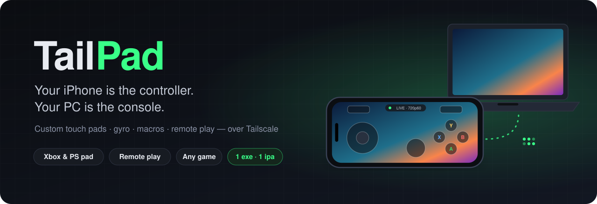
</p>

<p align="center">
  <a href="https://github.com/hamzaibnzakir/Tailpad/actions/workflows/build.yml"></a>
  
  
  
  
</p>

<p align="center">
  <b>Turn your iPhone into a game controller for your Windows PC — or stream the game to your phone and play it there.</b><br>
  Works anywhere your Tailscale reaches: the couch, another room, or across town.
</p>

<p align="center">
  <a href="#-get-started">Get started</a> ·
  <a href="#-features">Features</a> ·
  <a href="#-remote-play">Remote play</a> ·
  <a href="#-how-it-works">How it works</a> ·
  <a href="#-faq">FAQ</a>
</p>

---

<table>
  <tr>
    <td width="50%">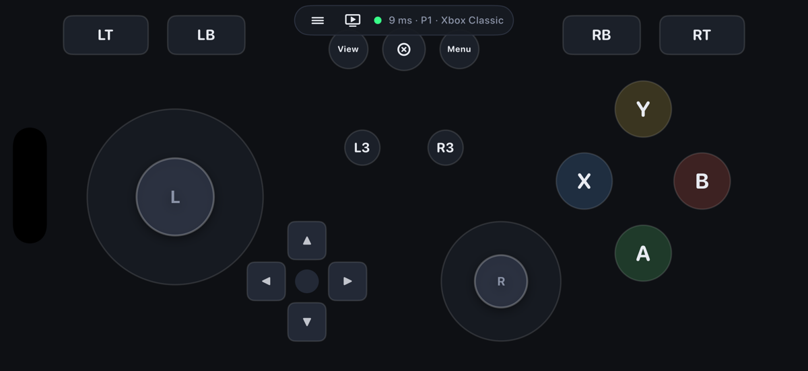</td>
    <td width="50%">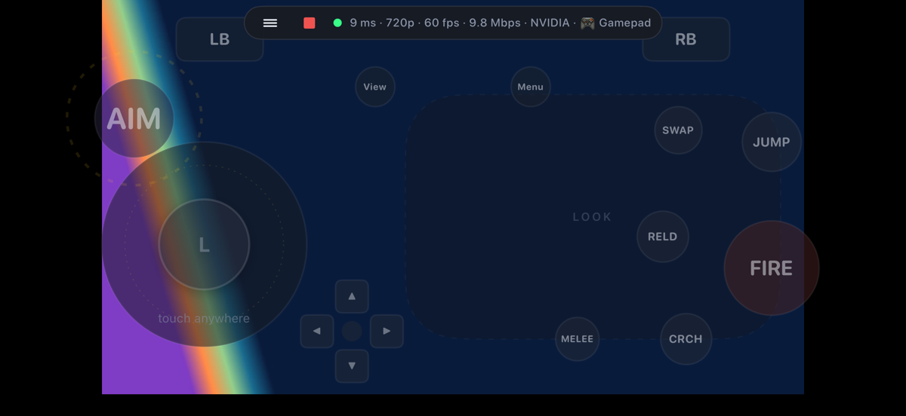</td>
  </tr>
  <tr>
    <td align="center"><sub><b>A real controller.</b> Windows sees an Xbox 360 or DualShock 4 pad.</sub></td>
    <td align="center"><sub><b>Remote play.</b> The game on your phone, with your layout see-through on top.</sub></td>
  </tr>
</table>

## ✨ Features

<table>
  <tr>
    <td width="33%" valign="top">
      <h3>🎮 Real controller</h3>
      Windows and games see an <b>Xbox 360</b> or <b>PlayStation&nbsp;(DS4)</b> controller, so it works in any game with controller support: Steam, Epic, Xbox app, repacks, emulators. Two phones means two players, up to four.
    </td>
    <td width="33%" valign="top">
      <h3>🖐️ Your layout</h3>
      Drag, resize, recolour and reshape every button. Use sticks, D-pads, analog trigger sliders and touchpads, across as many pages as you want. Share layouts as a link or a <code>.tailpad</code> file.
    </td>
    <td width="33%" valign="top">
      <h3>📺 Remote play</h3>
      Stream the PC game to your iPhone at 720p 60fps with sound. It's encoded on your graphics card (NVIDIA, Intel or AMD) and decoded in hardware on the phone. Pair an Xbox or PS controller to the phone and the touch controls hide themselves.
    </td>
  </tr>
  <tr>
    <td valign="top">
      <h3>🌀 Gyro</h3>
      Aim by moving the phone, as the right stick or as the PC mouse. Tilt to steer in racing games. Gyro can be always on, on while aiming, or on while a button is held. Emulators get the motion too, through the built-in DSU server.
    </td>
    <td valign="top">
      <h3>⚡ Smart buttons</h3>
      <b>Drag-out</b>: hold to aim, slide outward to fire. <b>Stick edge</b>: push to the edge to sprint. Buttons can also be <b>turbo</b>, <b>toggle</b> or <b>page switch</b>.
    </td>
    <td valign="top">
      <h3>🥋 Macros</h3>
      Record combos like quarter-circle-forward + punch. The PC plays them back with exact timing, so Wi-Fi jitter doesn't throw them off. A macro can run once or repeat while you hold the button.
    </td>
  </tr>
  <tr>
    <td valign="top">
      <h3>🔎 Finds your games</h3>
      Steam, Epic, and anything installed on your drives, including repacks. Games show up with their proper names and icons, and you can start them from the phone.
    </td>
    <td valign="top">
      <h3>🔁 Auto-switch</h3>
      Link a layout to a game. When that game is focused on the PC, the phone switches to its layout, and switches back when you leave.
    </td>
    <td valign="top">
      <h3>📳 Rumble</h3>
      When the game vibrates, your phone vibrates, with real Core Haptics rumble. In PlayStation mode, the game's lightbar colour glows on the phone too.
    </td>
  </tr>
</table>

## 🚀 Get started

You need **Tailscale** on the PC and on the iPhone, signed into the same account. Everything else is in two files.

### 1 · PC: `TailPad.exe`

1. Download **`TailPad.exe`** from the latest [release](https://github.com/hamzaibnzakir/Tailpad/releases) or [build](https://github.com/hamzaibnzakir/Tailpad/actions) and run it. It lives in the system tray.
2. **First launch only:** TailPad sets up its built-in controller driver. Click **Yes** on the Windows prompt.
3. Allow it through Windows Firewall when asked (Private networks).

That's it. There's no separate driver or video engine to download, because both are inside the exe.

### 2 · iPhone: `TailPad.ipa`

1. Download **`TailPad.ipa`** from the same release or build.
2. Install it with **[Sideloadly](https://sideloadly.io)** using your Apple ID.
3. Open the iPhone **Camera** and point it at the QR code in the PC app. That pairs them.

<p align="center">
  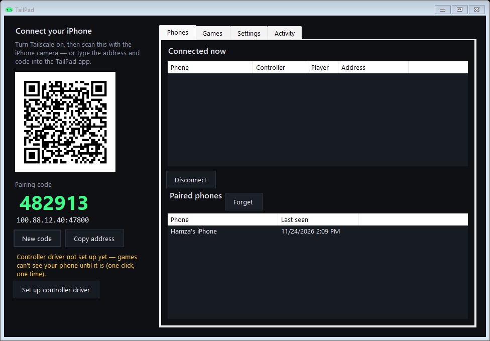
</p>

> [!NOTE]
> With a free Apple ID, sideloaded apps have to be re-signed every 7 days. Sideloadly can do this for you.

## 🖼️ Built-in layouts

Six starting points. Duplicate any of them and make it yours.

<table>
  <tr>
    <td>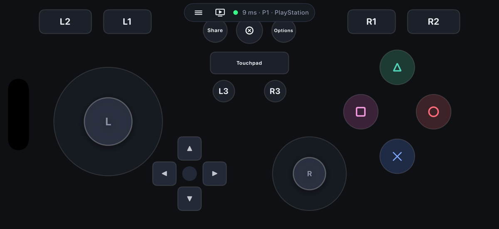<p align="center"><sub><b>PlayStation</b>: DS4 mode with touchpad click</sub></p></td>
    <td>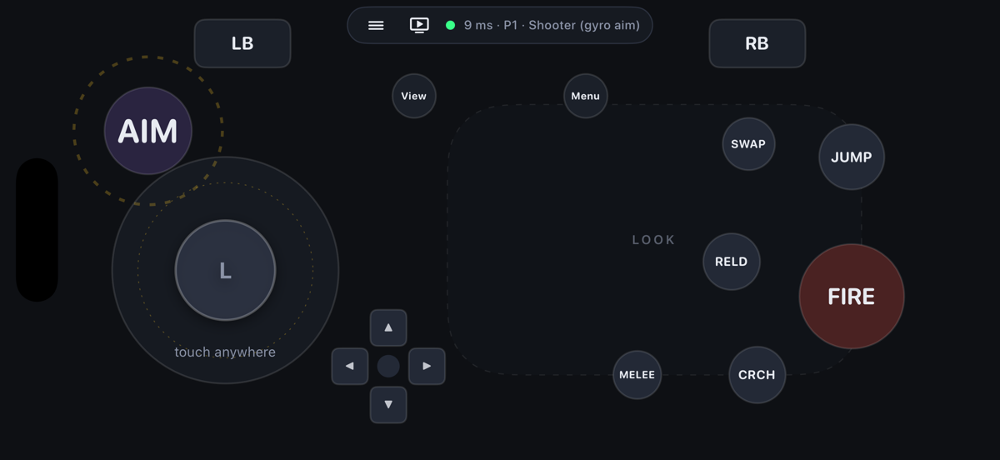<p align="center"><sub><b>Shooter</b>: gyro aim, drag-out fire, look touchpad</sub></p></td>
  </tr>
  <tr>
    <td>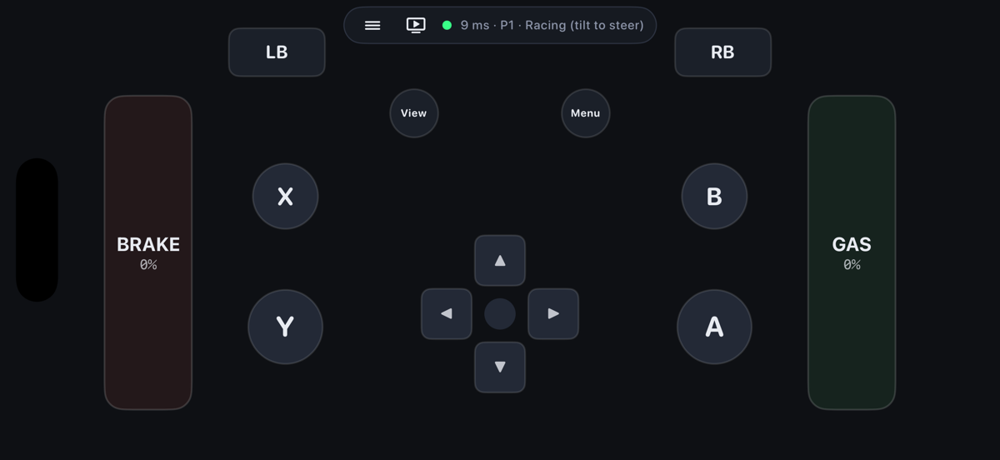<p align="center"><sub><b>Racing</b>: tilt to steer, analog gas and brake</sub></p></td>
    <td>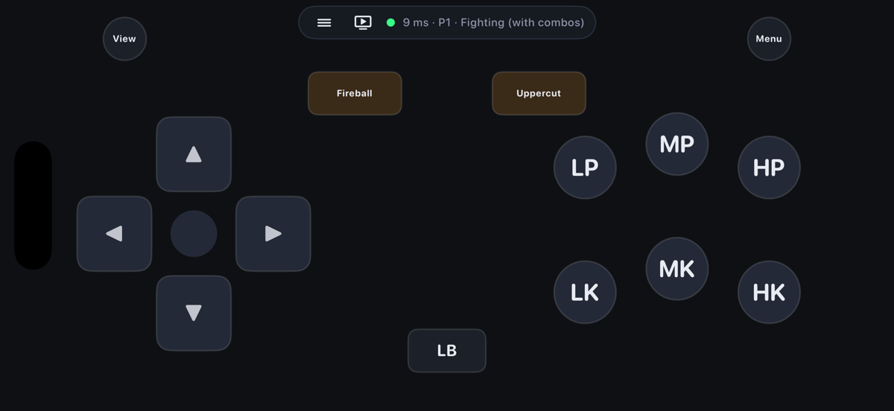<p align="center"><sub><b>Fighting</b>: 8-way pad, six buttons, combo macros</sub></p></td>
  </tr>
  <tr>
    <td>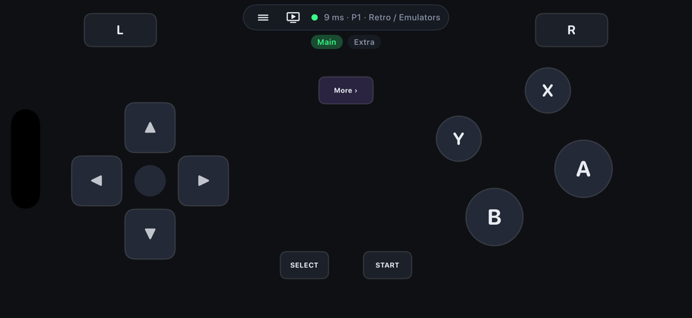<p align="center"><sub><b>Retro / emulators</b>: two pages</sub></p></td>
    <td>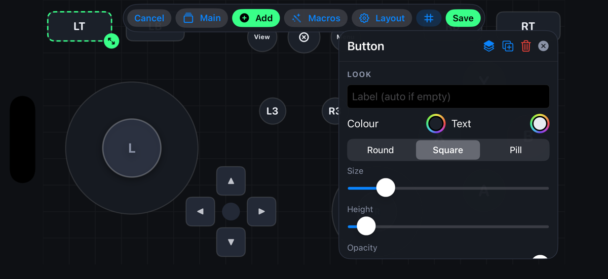<p align="center"><sub><b>The editor</b>: tap a control to change what it does</sub></p></td>
  </tr>
</table>

## 📺 Remote play

1. Open a game on your PC.
2. On the phone, tap **▶ TV** at the top of the controller.
3. Play. The status bar shows ping, resolution, fps, bitrate and which encoder is running.

<table>
  <tr>
    <td width="50%">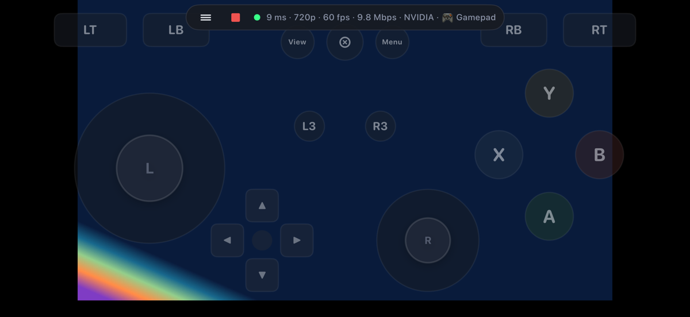</td>
    <td width="50%">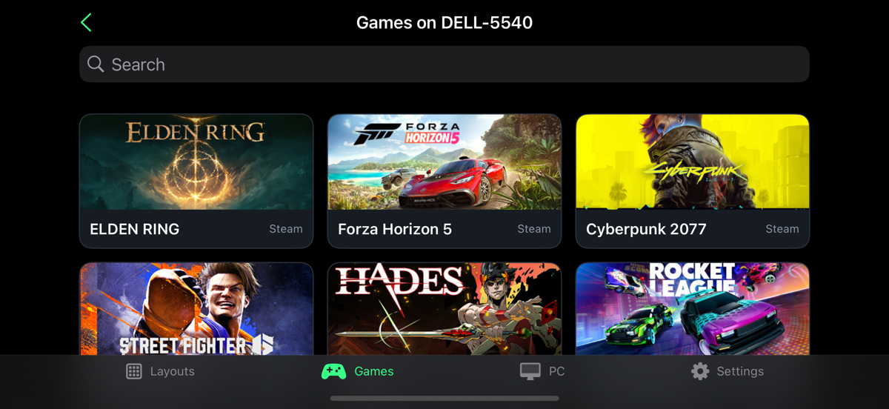</td>
  </tr>
  <tr>
    <td align="center"><sub>Streaming with the Xbox layout over the game</sub></td>
    <td align="center"><sub>Start PC games from the phone</sub></td>
  </tr>
</table>

| Setting | What it does |
|---|---|
| **Quality** | 540p60 · 720p30 · **720p60** (default) · 1080p60. Lower it if the stream stutters away from home. |
| **Game sound on the phone** | Game audio, Opus at 48 kHz |
| **Touch controls over the game** | How see-through your layout is, 15–100 % |
| **Hide touch controls when a controller is connected** | Pair an Xbox or PS controller to the iPhone and you see just the game |

The stream follows the window you're playing. If you click into a different game on the PC, the stream moves to it.

### 🫥 Background play: game on the phone, PC free for work

Tap a game in the phone's **Games** tab and choose **Play on my phone, keep using the PC**. TailPad starts it on a **hidden screen** that only your phone sees, so your real screen, mouse and keyboard stay yours. Use the ▭ button at the top of the controller (or the tray menu) to move a game that's already running to the hidden screen, or to bring it back.

- The hidden screen is a 720p virtual monitor that exists only while a game is on it. It touches your desktop only at one corner, so your mouse won't drift onto it.
- Only the game's sound goes to the phone. On the PC the game is turned down to almost nothing; it can't be fully muted, because Windows mutes an app before its sound can be captured. Your music and calls stay on the PC.
- While a game is in the background, gyro and touchpad don't move the PC's mouse.
- The game and your work share the same graphics, CPU and RAM. Light work next to a game is fine.

> [!TIP]
> Run the game in **windowed** or **borderless** mode at **1280×720**. If a game ignores the controller while you're working, turn on its **"run in background"** / **"pause when unfocused: off"** option. Most games read the Xbox controller fine in the background; some only listen when focused.

## 🧠 How it works

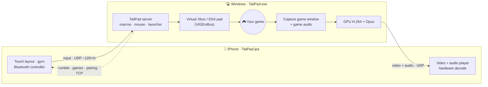

- **Private by default.** The PC only answers devices on your tailnet. Each phone pairs once with a 6-digit code, and 5 wrong guesses lock that address out for a minute.
- **Built for low lag.** Input goes over UDP about 120 times a second. Video is encoded with no B-frames and a keyframe every second, so if a packet is lost the picture recovers within a second instead of breaking up.
- **Never stuck.** If the phone goes quiet for half a second, every button and stick is released.
- **Background play.** A signed, open-source virtual display driver ([Virtual Display Driver](https://github.com/VirtualDrivers/Virtual-Display-Driver), MIT) provides the hidden screen. The game's window is moved onto it without taking focus away from you, and only the game's sound is captured, through Windows' per-app loopback.
- **Works on more PCs.** Screen capture uses the GPU when it can and falls back to a compatible method when it can't. Encoding tries NVIDIA, then Intel, then AMD, then Windows' own encoder, then software.

The full wire format is in **[docs/PROTOCOL.md](docs/PROTOCOL.md)**.

## ❓ FAQ

<details>
<summary><b>Does it work with games that aren't on Steam?</b></summary>
<br>
Yes. To Windows, TailPad is just a controller, so any game that supports a controller works. Games installed anywhere on your drives are found automatically, and you can add anything that's missing with <b>Games → Add game…</b>.
</details>

<details>
<summary><b>A game says to start it through its launcher (e.g. GTA V: "ERR_NO_LAUNCHER")</b></summary>
<br>
TailPad starts found games through their desktop or Start Menu shortcut, the same way a double-click does. If a game still won't start, open TailPad on the PC, go to <b>Games</b>, select the game, click <b>Change start file…</b> and pick the shortcut or launcher you normally use.
</details>

<details>
<summary><b>Background play opens the game on my PC screen instead</b></summary>
<br>
Some games (GTA V, many repacks) run as administrator, and Windows doesn't let a normal app move an administrator app's window. TailPad spots this and asks to restart itself as administrator. Click <b>Yes</b> and tap the game on your phone again. You can also turn on <b>Settings → Run TailPad as administrator</b>. The <b>Activity</b> log on the PC shows each background-play step if something else gets in the way.
</details>

<details>
<summary><b>Do I need to be on the same Wi-Fi?</b></summary>
<br>
No, just both on Tailscale. Same Wi-Fi gives the best lag and stream quality. Away from home, run <code>tailscale status</code> on the PC; if the phone shows <code>relay</code> instead of <code>direct</code>, the connection is going through a relay and will be slower.
</details>

<details>
<summary><b>The game doesn't react to the controller</b></summary>
<br>
Open TailPad on the PC and check it says <b>Controller driver: ready ✓</b>. If not, click <b>Set up controller driver</b> and choose Yes. Some older games only work with keyboard and mouse.
</details>

<details>
<summary><b>Gyro aims the wrong way in an emulator</b></summary>
<br>
In the iPhone app, go to Settings → Motion and flip the axis that's wrong. Emulators read motion from <code>127.0.0.1:26760</code> (DSU / cemuhook).
</details>

<details>
<summary><b>Why is TailPad.exe so big?</b></summary>
<br>
It carries the controller driver installer and the video engine (FFmpeg) inside it, so there's nothing else to install. Both are unpacked once on first use.
</details>

## 🛠️ Build from source

```bash
# PC (needs .NET 8): tests, then a single-file TailPad.exe
dotnet test pc/TailPad.Tests
pwsh scripts/get-ffmpeg.ps1 && bash scripts/get-driver.sh   # optional: bundle engine + driver
dotnet publish pc/TailPad.Host -c Release -o out
```

The iPhone app is built in the cloud by [GitHub Actions](.github/workflows/build.yml), so no Mac is needed. It uses XcodeGen, an unsigned build and an `.ipa` packaged for Sideloadly. Every push also screenshots each screen in the iOS simulator and checks screen capture and encoding on a real Windows machine.

```
pc/TailPad.Core     server, sessions, macros, DSU, game scanner, streaming core (cross-platform, tested)
pc/TailPad.Host     Windows tray app: ViGEm pads, capture, audio, launcher, QR pairing
pc/TailPad.Tests    end-to-end tests with a fake phone + real FFmpeg encodes
ios/TailPad         SwiftUI app: pad engine, editor, gyro, stream player, controllers
```

## 🙏 Built on

[ViGEmBus](https://github.com/nefarius/ViGEmBus) (virtual controllers) ·
[Virtual Display Driver](https://github.com/VirtualDrivers/Virtual-Display-Driver) (hidden screen) ·
[FFmpeg](https://ffmpeg.org) (capture and encoding, LGPL build by [BtbN](https://github.com/BtbN/FFmpeg-Builds)) ·
[NAudio](https://github.com/naudio/NAudio) ·
[Concentus](https://github.com/lostromb/concentus) (Opus) ·
[QRCoder](https://github.com/codebude/QRCoder) ·
[Tailscale](https://tailscale.com).
Licences are listed in [THIRD_PARTY_NOTICES.md](THIRD_PARTY_NOTICES.md).

If you only need game streaming, [Moonlight](https://moonlight-stream.org) + [Sunshine](https://github.com/LizardByte/Sunshine) and [Steam Link](https://store.steampowered.com/remoteplay) are excellent and worth a look. TailPad's focus is the phone as a fully customisable controller first, with remote play built into the same two files.
